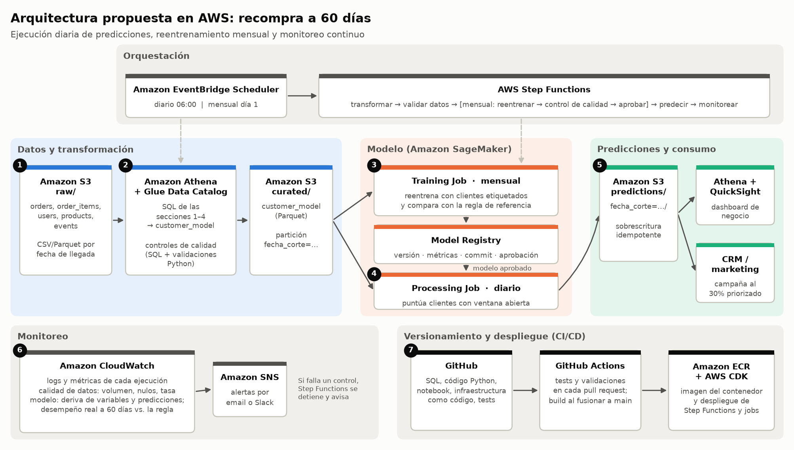

# Recompra a 60 días: The Look e-commerce

Caso práctico de Machine Learning Engineer. El objetivo es identificar a los clientes con alta probabilidad de realizar una nueva orden en los 60 días siguientes a su primera compra.

El trabajo completo, con explicaciones, resultados y gráficos, está en [`archivos/notebook.ipynb`](archivos/notebook.ipynb).

## Resultados principales

- **Tasa de recompra:** 5,6% de los clientes con 60 días completos de seguimiento.
- **Variable más predictiva:** la antigüedad del cliente al comprar. Quien hace su primera compra en la semana siguiente a registrarse recompra un 17,5%; quien se registró hace más de dos años, un 2,6%.
- **Efecto de cohorte:** la tasa de recompra crece con cada cohorte de registro, de ~2,5% (2019) a 17% (2024).
- **Modelo:** regresión logística con selección de variables, evaluada en el periodo de prueba (agosto–diciembre 2024):
  - Average Precision de 0,251, frente a 0,127 de un orden aleatorio.
  - Contactando al 30% de clientes con mayor puntuación, captura el 57% de los recompradores con una precision del 23%, el doble que una selección al azar.
  - Empata con una regla simple basada en la antigüedad del cliente, que se mantiene como referencia.

## Estructura del repositorio

```
├── archivos/
│   └── notebook.ipynb          # Notebook principal (SQL documentado + Python)
├── SQL/                        # Consultas de BigQuery, en el orden del notebook
│   ├── 01_exploracion.sql ... 12_validacion_usuarios.sql   # Perfilado y controles de calidad
│   ├── 13_customer_model.sql                               # Tabla analítica final
│   ├── 14_validacion_customer_model.sql                    # Controles de la tabla final
│   └── 15_tiempo_entre_compras.sql                         # Días hasta la segunda compra
├── data/
│   ├── customer_model.csv          # Exportación de la tabla analítica (una fila por cliente)
│   └── tiempo_entre_compras.csv    # Exportación de la consulta 15
├── outputs/
│   ├── predicciones_20250214.csv           # Predicciones para clientes con la ventana abierta
│   └── modelo_recompra_1.0_20250214.joblib # Pipeline entrenado + metadatos
├── docs/
│   ├── arquitectura_aws.png        # Diagrama de la arquitectura propuesta
│   └── diagrama_arquitectura.py    # Script que genera el diagrama
├── requirements.txt
└── README.md
```

## Cómo ejecutar

Requisitos: Python 3.13.

```bash
python -m venv .venv
# Windows
.venv\Scripts\activate
# macOS / Linux
source .venv/bin/activate

pip install -r requirements.txt
jupyter notebook archivos/notebook.ipynb
```

Después, ejecutar todas las celdas (*Run All*). También puede ejecutarse sin abrir Jupyter:

```bash
jupyter nbconvert --to notebook --execute --inplace archivos/notebook.ipynb
```

La ejecución completa tarda alrededor de un minuto. No requiere acceso a BigQuery: las consultas SQL se muestran como texto en el notebook y Python parte de los CSV de `data/`.

### Parámetros

Todo el proceso de Python se controla desde el diccionario `CONFIG` de la sección 5.1:

| Parámetro | Valor por defecto | Uso |
|---|---|---|
| `fecha_corte` | `None` (14/02/2025, última orden) | Fecha anterior para simular el proceso en ese momento, p. ej. `"2024-06-30"` |
| `pct_contacto` | `0.30` | Porcentaje de clientes que el negocio puede contactar |
| `ventana_dias` | `60` | Ventana de recompra |
| `frac_test`, `inicio_backtest`, `meses_por_fold` | `0.15`, `"2023-01-01"`, `3` | Diseño de la evaluación temporal |
| `vida_media_dias` | `365` | Ponderación por recencia en el entrenamiento |
| `modelo_version` | `"1.0"` | Versión registrada en las salidas |

Las salidas se nombran con la fecha de corte y se sobrescriben al reejecutar, por lo que repetir la ejecución no duplica resultados.

### Regenerar los datos desde BigQuery

Solo es necesario si cambian los datos de origen:

1. Ejecutar `SQL/13_customer_model.sql` en el proyecto `bussiness-case-tyc`. Crea la tabla `fabrizio_natal.customer_model`.
2. Exportar esa tabla como `data/customer_model.csv`.
3. Ejecutar `SQL/15_tiempo_entre_compras.sql` y exportar el resultado como `data/tiempo_entre_compras.csv`.

## Arquitectura en AWS



| Pieza | Diseño |
|---|---|
| Carga y transformación | Los datos llegan a S3. Athena ejecuta el SQL y escribe `customer_model` en Parquet |
| Ejecución | Diaria (predicción) y mensual (reentrenamiento), con EventBridge Scheduler y Step Functions. Entrenamiento y predicción con SageMaker |
| Predicciones | S3 particionado por fecha de corte, consultable con Athena; dashboard en QuickSight y exportación al CRM |
| Monitoreo | CloudWatch y SNS: calidad de datos, deriva y desempeño real frente a la regla de referencia |
| Código | GitHub, GitHub Actions, ECR y AWS CDK |

La explicación completa, incluida la integración con Snowflake, está en la sección 12 del notebook.

## Salida: predicciones

`outputs/predicciones_AAAAMMDD.csv` contiene una fila por cliente cuya ventana de 60 días sigue abierta en la fecha de corte:

| Columna | Descripción |
|---|---|
| `user_id` | Identificador del cliente |
| `probabilidad_recompra` | Probabilidad estimada de recompra en 60 días |
| `dias_restantes_ventana` | Días que quedan de la ventana de 60 días |
| `ranking`, `decil` | Posición del cliente; decil 1 = mayor probabilidad |
| `prioridad` | Alta (decil 1), Media (deciles 2–3), Baja (resto) |
| `contactar` | `True` para el `pct_contacto` de clientes con mayor probabilidad |
| `fecha_corte`, `modelo_version`, `fecha_proceso` | Trazabilidad |

## Supuestos

- **Compra válida:** orden con estado `Complete`, `Shipped` o `Processing`. Se excluyen `Cancelled` y `Returned`.
- **Primera compra:** primera orden válida del cliente, ordenando por `created_at` y `order_id`.
- **Recompra:** una nueva orden válida, distinta de la primera, dentro de los 60 días posteriores a la primera compra. Se cuenta a nivel de orden: los artículos de una misma orden no suman compras.
- **Fecha de corte:** la última orden disponible (14/02/2025).
  - Los clientes sin 60 días completos de seguimiento tienen etiqueta nula y no se usan para entrenar.
  - Son los clientes que se puntúan.
- **Sin fuga de información:** las variables usan solo información disponible al momento de la primera compra: la propia orden, el perfil del cliente y la navegación anterior.
  - Se asume que el contenido de la cesta se conoce al confirmar la compra.
  - Los costos y márgenes de inventario se excluyen por inconsistencias temporales.
- **Estados y atributos:** los estados de las órdenes y los atributos de los usuarios son instantáneas actuales, no históricos.
- **Calibración:** las probabilidades subestiman la tasa real cuando esta crece entre cohortes. Para decidir a quién contactar se usa el ranking.
- **Datos ficticios:** el dataset es ficticio, por lo que algunos patrones (como el efecto de cohorte) pueden ser artefactos de su generación.
